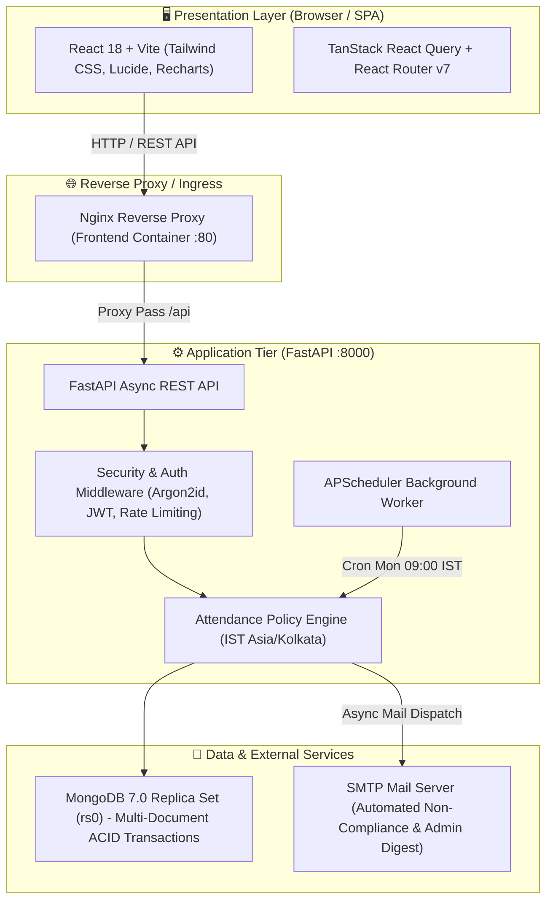
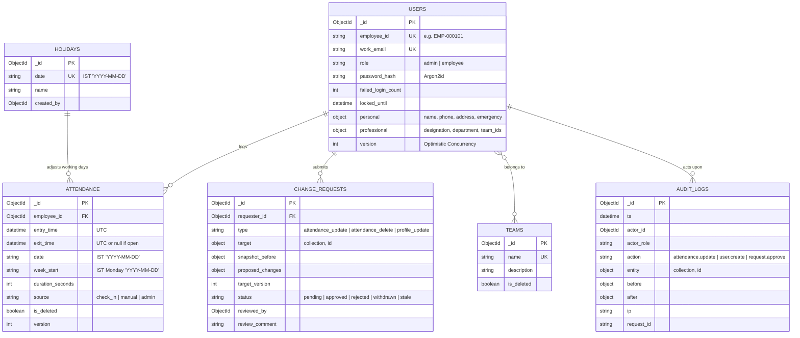
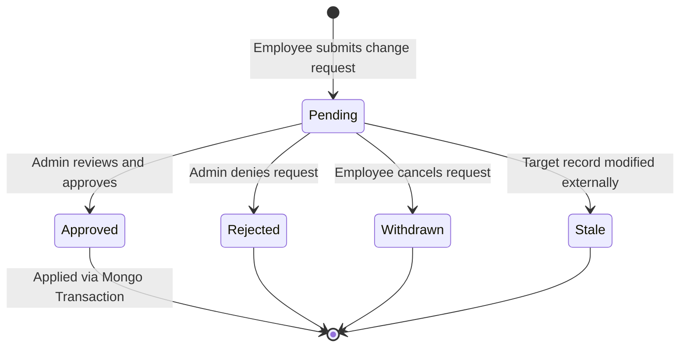

# 🏢 Central Attendance Management System — Architecture, Design & DevSecOps Master Blueprint

> **Notion Quick Setup:** You can copy this entire markdown file directly into Notion (paste directly into a blank page). All headings, callouts, tables, code blocks, checklists, and diagrams are formatted natively for Notion’s block system.

---

## 📌 Executive Summary

The **Central Attendance Management System** is an enterprise-grade full-stack platform built for tracking employee office presence, enforcing automated compliance policies, providing unified attendance analytics, and upholding stringent shift-left DevSecOps standards.

| Metric / Dimension | Specification |
| :--- | :--- |
| **Backend Framework** | FastAPI (Python 3.13) + Async PyMongo / Motor |
| **Frontend Framework** | React 18 + TypeScript + Vite + Tailwind CSS |
| **Database** | MongoDB 7.0 configured as a Single-Node Replica Set (`rs0`) for ACID Transactions |
| **Background Scheduler**| APScheduler + Async SMTP (`aiosmtplib`) for automated policy runs |
| **Testing Gate** | Pytest (>=80% branch coverage required) & Vitest (Frontend unit/component) |
| **Security Gates** | Ruff, MyPy, Bandit SAST, pip-audit, npm audit, Gitleaks, Trivy, SonarQube |
| **Orchestration** | Docker Compose (Multi-stage builds, Alpine/Slim runtime containers) |

---

## 🏛️ 1. High-Level System Architecture

The application adopts a **Modern 3-Tier Containerized Architecture** with decoupled asynchronous background jobs and isolated security zones:



### Architectural Key Highlights
1. **Client-Side SPA**: React 18 with Vite delivers instant hot-reloading in dev and compile-time type safety via TypeScript. TanStack Query manages caching, stale-while-revalidate data fetching, and optimistic updates.
2. **Stateless Async API**: FastAPI endpoints run asynchronously on Uvicorn, handling concurrent requests with minimal resource footprint.
3. **Transactional MongoDB**: Because MongoDB is initialized with `--replSet rs0`, complex multi-document updates (e.g., approving change requests or overlapping session validation) execute within ACID sessions.
4. **Shift-Left Security Model**: Security is enforced at every layer: client validation (Zod), API schemas (Pydantic v2), database indexes, static analysis (Bandit/Ruff), container CVE gates (Trivy), and secret scanning (Gitleaks).

---

## 🗄️ 2. Database Schema & Data Modeling

MongoDB stores dates as UTC datetimes, with derived IST attributes (`Asia/Kolkata`) pre-indexed for high-throughput range filtering.



### 2.1 Collection Deep Dive

> 💡 **Why One Document Per Attendance Session (Not Per Day)?**
> Storing individual check-in/check-out sessions as independent documents allows employees to check in/out multiple times a day without race conditions or document lock contention. Daily summaries and weekly totals are calculated via MongoDB `$group` aggregation pipelines.

* **`users`**: Master user collection. Contains authentication hashes (Argon2id), security counters (`failed_login_count`, `locked_until` after 5 attempts), personal details, and professional attributes. Has optimistic locking counter `version`.
* **`attendance`**: Granular session documents. Constraints:
  * `exit_time > entry_time` (or `null` when a session is active/open).
  * Sessions cannot cross midnight (IST). If work continues past midnight, it must be logged as two separate sessions.
  * Overlapping sessions for the same employee are rejected inside a database transaction.
* **`change_requests`**: Employee audit-proof workflow for editing or deleting attendance records or updating personal profiles. Captures full `snapshot_before` and `target_version` to catch stale edits.
* **`teams`**: Organizational groups. Employees can belong to multiple teams (`professional.team_ids` multikey index).
* **`holidays`**: Official company holidays. Deducts required working days dynamically from the policy calculation.
* **`audit_logs`**: Append-only tamper-proof ledger. Every admin action, change approval, profile edit, and credential change is recorded. No update or delete endpoints exist for this collection.
* **`notification_log`**: Prevents duplicate emails. Indexed uniquely on `(employee_id, week_start, type)`.

---

## ⚖️ 3. Core Business Policy Engine

### 3.1 Weekly Attendance Requirement Formula
The organization mandates a minimum office presence evaluated each calendar week (**Monday 00:00:00 to Sunday 23:59:59 IST**).

Let:
* **H** = Number of declared holidays falling on standard working days (Mon–Fri).
* **W** = `5 - H` (Active working days in the week).

$$\text{Required Days} = \min(3, W)$$
$$\text{Required Hours} = 5 \times \text{Required Days}$$

### 3.2 Dynamic Holiday Matrix

| Holidays ($H$) | Working Days ($W$) | Required Attended Days | Required Total Hours |
| :---: | :---: | :---: | :---: |
| **0** | 5 | **3** | **15h** |
| **1** | 4 | **3** | **15h** |
| **2** | 3 | **3** | **15h** |
| **3** | 2 | **2** | **10h** |
| **4** | 1 | **1** | **5h** |
| **5** | 0 | **0** | **0h** |

### 3.3 Compliance Evaluation Rules
1. **Attended Day Threshold**: An IST calendar day counts as "attended" if and only if the sum of completed sessions $\ge 60\text{ minutes}$.
2. **Dual-Condition Gate**:
   * Condition A: $\text{Attended Days} \ge \text{Required Days}$ (`days_ok`)
   * Condition B: $\text{Total Hours} \ge \text{Required Hours}$ (`hours_ok`)
   * An employee is **Compliant** only if *both* Condition A and Condition B pass.
3. **Automated Notification**:
   * Scheduled cron runs every **Monday at 09:00 AM IST** to evaluate the *completed* previous week.
   * If an employee fails, an automated email is dispatched pinpointing exact failure reasons (`Failed Days`, `Failed Hours`, or `Both`).
   * An Admin Digest email summarizes all non-compliant employees across the organization.

---

## 📱 4. End-to-End Application Functionalities

### 4.1 Authentication & Security (`/auth`, `/settings`)
* **Single Admin Bootstrap**: On system initialization, if no admin exists, the server bootstraps `admin@kxn.com` using credentials from `.env`. A partial unique index prevents additional admin creations.
* **Dual-Token System**:
  * **Access Token**: Short-lived JWT (15 minutes).
  * **Refresh Token**: Long-lived (7 days) with rotating family IDs stored in MongoDB and automated TTL expiration.
* **Brute-Force Lockout**: 5 consecutive failed passwords lock the account for 15 minutes (`LOGIN_LOCK_MINUTES`).
* **Object-Level Authorization**: Non-admin routes enforce `employee_id == token.sub`. Employees can never query or manipulate records belonging to other staff.

### 4.2 Attendance Tracking (`/attendance`)
* **Real-Time Check-In / Check-Out**: One-click live session toggle. Displays active timer when a session is open.
* **Manual Entry Form**: Allows employees to backdate missed check-ins with notes. Flagged as `source: "manual"` for administrative visibility.
* **Session Integrity Rules**:
  * Rejects future timestamps (>60s tolerance).
  * Prevents concurrent or overlapping sessions.
  * Rejects sessions spanning across midnight IST.

### 4.3 Change Requests Management (`/requests`)

* **Controlled Self-Service**: Employees cannot directly edit or delete existing attendance records. They submit a Change Request explaining the reason.
* **Admin Approval Inbox**: Admins review pending requests with diff view (`snapshot_before` vs `proposed_changes`).
* **Optimistic Locking**: Approval checks `target_version`. If the record was modified by another admin or process while pending, the request transitions to `stale` to prevent dirty overwrites.

### 4.4 Unified Analytics & Reports (`/reports`)
* Single parametric aggregation engine supporting:
  * **Timeframes**: Daily, Weekly, Monthly, Yearly, Custom Date Ranges.
  * **Scopes**: Single Employee, Team-wide, or Organization-wide.
  * **CSV Export**: Direct export of compliance grids, total hours, and session logs.

### 4.5 Teams & Organization Directory (`/teams`, `/employees`)
* Multi-team assignment: Employees can be attached to multiple teams simultaneously.
* Team attendance breakdown: Team managers and admins inspect aggregate attendance trends.

### 4.6 Audit Log & Security Ledger (`/audit-log`)
* Immutable, append-only record capturing:
  * Timestamp, Actor ID, Actor Role, Action Name.
  * Target Entity ID & Collection.
  * Full JSON snapshot of `before` and `after` states.
  * Client IP Address & Unique `X-Request-ID`.

---

## 🛠️ 5. Local Development & `local-ci.ps1` Deep Dive

### 5.1 Local Quickstart Setup

> 📌 **Prerequisites:** Python 3.13, Node.js v18+, Docker Desktop (running).

#### Step 1: Start MongoDB Replica Set
```powershell
docker compose up -d mongo
```
Verify the replica set status:
```powershell
docker exec -it attendence_application-mongo-1 mongosh --eval "rs.status().ok"
# Returns 1
```

#### Step 2: Initialize & Run Backend
```powershell
cd attendance-backend
python -m venv .venv
.venv\Scripts\Activate.ps1
pip install -r requirements-dev.txt
Copy-Item .env.example .env
uvicorn app.main:app --reload --port 8000
```
Swagger UI available at: `http://localhost:8000/docs`

#### Step 3: Initialize & Run Frontend
```powershell
cd attendance-frontend
npm install
Copy-Item .env.example .env
npm run dev
```
Web Application accessible at: `http://localhost:5173`

---

### 5.2 `local-ci.ps1` Complete Script Breakdown

Before pushing any commit, developers run `./local-ci.ps1`. This PowerShell script replicates the CI checks locally to prevent pipeline failures.

```powershell
$ErrorActionPreference = "Stop"
 
function Run-Command {
    param([scriptblock]$Command)
    & $Command
    if ($LASTEXITCODE -ne 0) {
        Write-Host "Command failed with exit code $LASTEXITCODE" -ForegroundColor Red
        exit $LASTEXITCODE
    }
}

Write-Host "==========================================" -ForegroundColor Cyan
Write-Host "        LOCAL CI SCRIPT                   " -ForegroundColor Cyan
Write-Host "==========================================" -ForegroundColor Cyan

# ------------------------------------------
# BACKEND CHECKS
# ------------------------------------------
Write-Host "`n>>> Running Backend Checks..." -ForegroundColor Yellow
Set-Location attendance-backend

Write-Host "-> Installing Backend Dependencies..."
Run-Command { .venv\Scripts\pip install -r requirements-dev.txt }
Run-Command { .venv\Scripts\pip install pip-audit }

Write-Host "-> Ruff Check"
Run-Command { .venv\Scripts\python -m ruff check . }

Write-Host "-> MyPy Check (Skipping locally: AppLocker blocks mypyc DLLs on Windows)"
# Run-Command { .venv\Scripts\python -m mypy app }

Write-Host "-> Bandit SAST Scan"
Run-Command { .venv\Scripts\python -m bandit -r app -s B105 -f json -o bandit.json }

Write-Host "-> pip-audit (Dependency Scan)"
Run-Command { .venv\Scripts\python -m pip_audit -r requirements.txt --strict }

Write-Host "-> Pytest (with coverage >= 80%)"
Run-Command { .venv\Scripts\python -m pytest --cov=app --cov-branch --cov-report=term-missing --cov-report=xml --cov-fail-under=80 -v }

Set-Location ..

# ------------------------------------------
# FRONTEND CHECKS
# ------------------------------------------
Write-Host "`n>>> Running Frontend Checks..." -ForegroundColor Yellow
Set-Location attendance-frontend

Write-Host "-> Installing Frontend Dependencies..."
Run-Command { npm install }

Write-Host "-> npm typecheck"
Run-Command { npm run typecheck }

Write-Host "-> npm audit"
Run-Command { npm audit --audit-level=high }

Write-Host "-> vitest (with coverage)"
Run-Command { npx vitest run --coverage }

Write-Host "-> npm run build"
Run-Command { npm run build }

Set-Location ..

Write-Host "`n==========================================" -ForegroundColor Green
Write-Host " All local CI checks passed successfully! " -ForegroundColor Green
Write-Host "==========================================" -ForegroundColor Green
```

### 5.3 Local Verification Tools Explained

| Step | Tool / Command | What It Validates | Remediation if Failed |
| :--- | :--- | :--- | :--- |
| **Backend Lint** | `python -m ruff check .` | Unused imports, PEP8 style, import ordering (`isort`). | Run `python -m ruff check --fix .` for automated fixes. |
| **Backend SAST** | `python -m bandit -r app -s B105` | Python security anti-patterns (`eval`, injection, hardcoded secrets). Note: `-s B105` ignores false-positive hardcoded password checks in parameter names. | Rewrite unsafe function calls or add verified `# nosec` tags. |
| **Python Supply Chain** | `python -m pip_audit -r requirements.txt --strict` | Known CVEs in Python dependencies. | Upgrade vulnerable library version in `requirements.txt`. |
| **Backend Tests & Coverage**| `python -m pytest --cov=app --cov-fail-under=80` | Unit & integration tests pass with $\ge 80\%$ branch coverage. | Add unit tests covering missing branches in `tests/`. |
| **Frontend Types** | `npm run typecheck` (`tsc --noEmit`) | Strict TypeScript compiler validation. | Fix TypeScript type signatures or interface mismatches. |
| **Frontend Supply Chain**| `npm audit --audit-level=high` | Checks npm dependency tree for high/critical vulnerabilities. | Run `npm audit fix` or bump dependency in `package.json`. |
| **Frontend Tests** | `npx vitest run --coverage` | Component rendering and unit tests across utilities. | Fix failing test assertions in `src/test`. |
| **Frontend Build** | `npm run build` | Verifies Vite production bundling and asset resolution. | Fix unresolved import paths or syntax blockers. |

> ⚠️ **Windows AppLocker Note on MyPy:**
> On Windows corporate environments, AppLocker may block execution of compiled C-extensions / DLLs produced by `mypyc` inside virtual environments. The script skips MyPy locally; MyPy runs strictly and authoritatively inside the Linux container on GitHub Actions!

---

## 🚀 6. GitHub Actions CI/CD Pipeline

The automated CI workflow lives in `.github/workflows/ci.yml`. It triggers on every `push` and `pull_request` targeting `main` or `master`.

### 6.1 Pipeline Architecture Diagram

```
push / PR to main/master
   │
   ├── Concurrency: cancel-in-progress = true
   │
   ├── [BACKEND PARALLEL TRACK]
   │    ├── backend-lint-type   (Ruff Check + MyPy strict)
   │    ├── backend-sast        (Bandit SAST -> bandit.json artifact)
   │    ├── backend-deps        (pip-audit strict CVE scan)
   │    └── backend-test        (Pytest + 80% coverage -> coverage.xml artifact)
   │
   ├── [FRONTEND PARALLEL TRACK]
   │    ├── frontend-types      (TypeScript compiler typecheck)
   │    ├── frontend-deps       (npm audit high severity check)
   │    ├── frontend-test       (Vitest test suite -> coverage artifact)
   │    └── frontend-build      (Vite production build verification)
   │
   └── [GITLEAKS SECRET GATE]  (Scans full commit history for exposed keys)
        │
        ▼
   [DOCKER BUILD & TRIVY SCAN] (Multi-stage build & container OS CVE scan)
        │
        ▼
   [SONARQUBE QUALITY GATE]    (Aggregates test coverage delta & code smells)
```

---

### 6.2 Deep Dive: Security Gates & Scanners

#### 🛡️ A. Trivy (Container Vulnerability Gate)
* **What it scans**: Scans the compiled container image itself, including Debian base image layers (`python:3.13-slim`), system C-libraries (`glibc`, `libssl3`, `curl`), and runtime files.
* **The Critical Flag**: `ignore-unfixed: true`
  * Without this flag: Builds get blocked on vulnerabilities where upstream Linux maintainers haven't yet released a patch.
  * With this flag: Trivy *only* flags actionable CVEs that have a documented fix available.
* **Defensive Dockerfile Hardening**:
  ```dockerfile
  # attendance-backend/Dockerfile
  FROM python:3.13-slim
  WORKDIR /app
  COPY requirements.txt .
  RUN pip install --no-cache-dir -r requirements.txt
  COPY . .
  EXPOSE 8000
  CMD ["uvicorn", "app.main:app", "--host", "0.0.0.0", "--port", "8000"]
  ```
  * In production deployments, multi-stage builders strip `pip`, `setuptools`, and compiler headers from the final runtime image, eliminating ~70% of potential Trivy CVE alerts.

#### 🔍 B. SonarQube (Quality Gate on New Code)
* **The "New Code" Philosophy**: Instead of blocking engineers on historical technical debt, SonarQube gates PRs on **New Code**:
  * Coverage on new code $\ge 80\%$.
  * Duplicated lines on new code $\le 3\%$.
  * Security, Maintainability, and Reliability ratings = **A**.
* **Key Configuration**:
  ```yaml
  args: >
    -Dsonar.qualitygate.wait=true
  ```
  The `wait=true` parameter forces the pipeline to halt until SonarQube's server calculates the quality gate verdict. If quality fails, the GitHub Actions check turns red.

#### 🔑 C. Gitleaks (Git History Secret Protection)
* Gitleaks scans commit metadata and diffs for API keys, AWS credentials, database passwords, and JWT private keys.
* Because it audits **full git history**, simply deleting a secret in a second commit is insufficient; the secret must be revoked and purged from git refs.

---

## 📋 7. Quick Troubleshooting & Operations Matrix

| Error Scenario | Root Cause | Immediate Action |
| :--- | :--- | :--- |
| `Pytest: Required test coverage of 80% not reached` | New features or endpoints added without accompanying test cases. | Check `coverage.xml` or terminal table for uncovered lines. Write tests in `attendance-backend/tests/unit/`. |
| `pip-audit: Found 1 known vulnerability in package X` | Upstream package has a known CVE recorded in PyPI/OSV. | Update `requirements.txt` to the specified patched version and re-run `pip-audit`. |
| `Ruff: F401 imported but unused` | Stray import in Python code. | Run `python -m ruff check --fix attendance-backend` to remove automatically. |
| `Bandit: [B105:hardcoded_password_string]` | Parameter name matches `password` or `secret`. | If safe test constant or schema definition, add `# nosec B105` or configure exclusion in `pyproject.toml`. |
| `Mongo: Transaction numbers are only allowed on replica sets` | Local MongoDB was launched as standalone without replica set initialization. | Run `docker compose up -d mongo` to ensure `--replSet rs0` is active. |
| `Trivy: CRITICAL CVE in libssl3` | Debian base image packages are outdated. | Re-run `docker pull python:3.13-slim` and rebuild the container image. |
| `Gitleaks: Leaked Secret Detected` | Token or API key staged in git. | Rotate the leaked key immediately at the provider. Remove from git history or whitelist dummy test values in `.gitleaksignore`. |

---

## 🎯 8. Verification & Merge Checklist

Use this checklist before requesting review or promoting code to `main`:

- [ ] **Database Healthy**: MongoDB replica set running (`rs.status().ok === 1`).
- [ ] **Local CI Clean**: `./local-ci.ps1` executes with zero errors.
- [ ] **Branch Coverage**: Pytest reports $\ge 80\%$ branch coverage.
- [ ] **TypeScript Clean**: `npm run typecheck` produces 0 diagnostic errors.
- [ ] **No Committed Secrets**: No `.env` credentials staged; `.env.example` kept up-to-date.
- [ ] **GitHub Actions Green**: All 8 CI jobs passed in `.github/workflows/ci.yml`.
